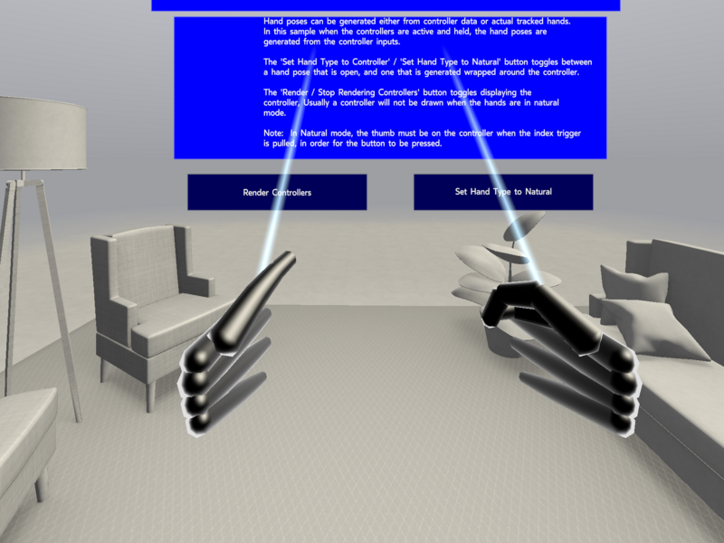
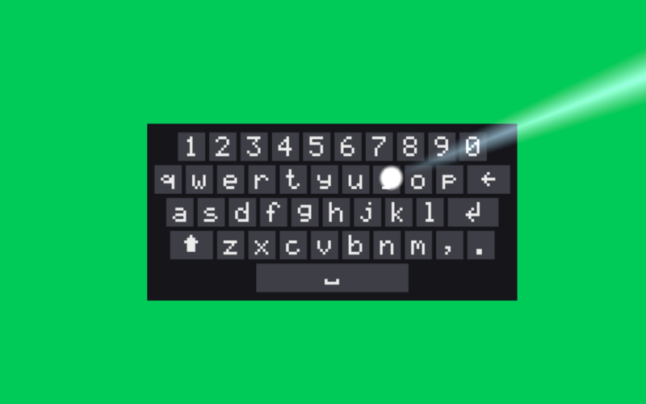

# puppetxr

An OpenXR simulator runtime. Point any unmodified OpenXR app at it and get a simulated
headset and two controllers driven by keyboard and mouse, with the app's frames in a mirror
window or offscreen. No headset, no service, no daemon.


| Tracked hands pinching, driven by `puppetxrctl` | Meta's virtual keyboard, typed on with the controller ray |
|---|---|
|  |  |

Agents working on this repository: read `AGENTS.md`.

## Goals

- **Simple.** One library (`libpuppetxr.so` / `puppetxr.dll`) and its manifest, loaded by the
  standard OpenXR loader into the app's process. Shaders, UI, dependencies and the simulated
  rooms are linked in; a rooms folder next to it may add more rooms.
- **Deterministic.** Same inputs, same frames, bit for bit: own math, fixed-step clock, fixed
  update order. Determinism has tests.
- **Reproducible bugs.** Record a session, replay it bit-identically, attach the recording to
  the bug report.
- **Agent ready.** `puppetxrctl` drives a running simulator from the command line: poses, inputs,
  pause and step, screenshots, recordings. Headless mode runs in CI.
- **Robust.** Every `xr*` call validates its input and returns an error instead of crashing.

## Features

- Linux, Windows and macOS; Vulkan (on macOS through MoltenVK), OpenGL, OpenGL ES, D3D11, D3D12, Metal
- Headset presets: Quest 3 (default), Quest 3S, Quest 2, Quest Pro
- Controllers: Meta Touch Plus, Touch Pro, Oculus Touch, KHR simple; hand tracking with
  pinch, grab and microgestures
- Body tracking (Meta's full body, fidelity, calibration): a skeleton in Meta's joint axes that
  follows the head, reaches for the controllers and keeps its feet on the floor; tests reshape
  and pose it to check retargeting (`docs/body-tracking.md`)
- Face and eye tracking (Meta's): expressions, visemes, blinks and a gaze the mouse can steer
  (`docs/face-tracking.md`)
- Simulated rooms with passthrough, passthrough camera images, scene mesh, semantic entities,
  anchors and raycasts; tracking drift (a step or a steady rate) to test world locking
- Props: keyboards and QR codes the app can track
- Fault injection: anchor requests and frame calls (`xrWaitFrame`, `xrBeginFrame`,
  `xrLocateViews`, `xrEndFrame`) fail with a chosen error, to test an app's error handling
- Apps on Meta's XR SDKs (OVRPlugin, Unity and Unreal) run without settings: puppetxr recognises
  OVRPlugin and answers as it expects (`docs/config.md`, Known modules)
- Works from editors' play modes: puppetxr's window comes in front with Unreal's VR Preview and
  goes when it stops
- 109 extensions, list in `docs/extensions.md`
- ImGui panels in the mirror window for devices, inputs, clock, room, recording and performance (frame rate and a frame time graph)
- An OpenXR API trace of every call with its arguments and results (`PUPPETXR_TRACE`)
- A C API (`src/puppetxr.h`) for tests and tools

## Build

Requirements: CMake 3.25+, Ninja, a C++20 compiler (GCC, clang or MSVC), `glslc` (Vulkan
SDK or shaderc). The dependencies are in `third_party/`; the build downloads nothing.

```
cmake -B build -G Ninja -DCMAKE_BUILD_TYPE=Release -DCMAKE_INSTALL_PREFIX=$HOME/.local
cmake --build build
cmake --install build
XR_RUNTIME_JSON=$HOME/.local/share/openxr/1/puppetxr.json <your openxr app>
```

Add `PUPPETXR_HEADLESS=1` to run without a window, `PUPPETXR_CONTROL=1` to enable `puppetxrctl`.
For development use the presets (`cmake --preset gcc-debug`, on macOS `mac-debug`; list and
the macOS dependencies in `docs/building.md`).
Releases (Linux and Windows binaries, source tarballs) are on the GitHub releases page,
built by `.github/workflows/release.yml` from the scripts in `tools/dist/` (`docs/building.md`).

Or let an agent do it:

> Read AGENTS.md and docs/building.md, install the build dependencies, build puppetxr in Release,
> run the tests, install it to ~/.local and tell me how to start my OpenXR app with it.

## Controls

A click into the view takes the mouse: it looks around and its buttons are the controller's;
Esc gives it back. Profiles say what the keys drive: 1 walks (WASD, Q/E), 2 drives the
thumbsticks, 3 moves both hands for a panel on one and a pointer on the other; ] goes to the
next, [ back, and your own go in the config. Tab shows the panels, F1 the controls. Full
mapping in `docs/config.md`.

## Testing

```
cmake --preset gcc-debug && cmake --build --preset gcc-debug && ctest --preset gcc-debug
```

- Unit tests per layer and end-to-end tests that run apps headless and compare screenshots
  and recordings. GPU tests also pass on software rasterizers (lavapipe, llvmpipe, WARP).
- CI runs the unit tests of every pull request on Linux, Windows and macOS; the label `full-ci` adds
  the other presets, all samples and the Linux and macOS release builds (`docs/testing.md`, CI).
- The OpenXR conformance test suite (`-DPUPPETXR_BUILD_CTS=ON`) runs as ctest entries, including
  the interactive input, composition and scenario tests, scripted and checked against
  approved images; on Windows also on D3D11, D3D12 and OpenGL over WGL.
- Real apps run as tests (`-DPUPPETXR_BUILD_SAMPLES=ON`): the Meta OpenXR SDK samples, Godot's
  official XR demos on both of Godot's renderers (OpenGL over GLX, Vulkan; on Windows Vulkan),
  the samples of the Godot OpenXR vendors plugin, hello_xr and Monado's xrgears and
  openxr-simple-example, and on Windows Meta's Unity MRUK, Shared Spatial Anchors, Starter and Depth API
  samples (`-DPUPPETXR_UNITY`) and its Unreal MRUK, Passthrough, Occlusion, Shared Anchors, Interaction
  SDK and Movement samples (`-DPUPPETXR_UNREAL`, on D3D11, D3D12 and Vulkan with the mobile and desktop renderers), scripted
  through `puppetxrctl` and compared against reference screenshots. On macOS the Godot demos on
  Vulkan, hello_xr and Meta's Unity MRUK samples as an Apple silicon player on Metal.
- Sanitizer (`clang-asan`, `clang-tsan`) and `clang-tidy` presets; on Windows the `win-clang-*`
  and `msvc-*` presets, and from Linux `mingw-debug` runs the Windows build in Wine.

Details in `docs/testing.md`.

## Docs

`docs/README.md` lists every document. License: MIT (`LICENSE`); the code in `third_party/` keeps
its own licenses (`third_party/README.md`).
